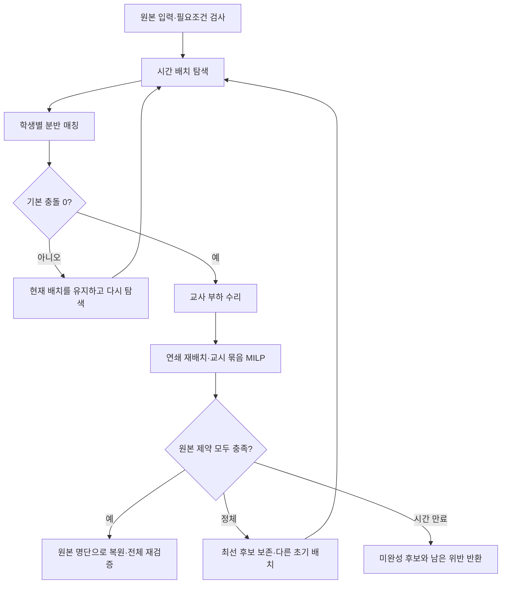

# 제한된 격자에서 배치·분반 공동 탐색

2026-09-22. 구현: `algorithm/coordinatedSolver.ts`. UI 기본 전략은 `coordinated`이며 이전 전략도 선택할 수 있다.

## 문제와 변경

전 학년 814개 수업 픽스처는 5일×7교시에서 학년별 금지 칸을 빼면 일부 학생의 가용 칸과 수강 시수가 같다. 빈 칸으로 수업 하나를 옮기는 방식은 다른 학생이나 교사의 수업에 막힌다. 기존 파이프라인은 재분반 후 배치를 처음부터 다시 풀고, 완성 직전 배치의 정보가 소실된다. 여러 단계마다 별도 시간 예산을 사용하므로 화면의 표준 시간보다 훨씬 오래 실행되기도 한다.

기존 알고리즘으로도 이번 픽스처의 해를 찾았으므로, 탐색 실패를 격자 용량 부족이나 불가능의 증거로 해석하지 않는다. 시간 칸을 늘리거나 교사 제약을 끄는 대신 아래의 공동 탐색을 추가했다.



1. **배치와 명단을 교대로 개선한다.** 교사 부하만 임시로 완화한 탐색 결과에서 학생별 MRV 백트래킹으로 분반을 매칭하고, 같은 배치를 다음 탐색의 시작점으로 넘긴다. 후보를 평가할 때는 항상 원본 제약을 사용한다.
2. **교사 수리에서 탐색 범위를 넓힌다.** Kempe 교환 뒤 모든 제약을 켠 국소탐색을 이어서 실행한다. 연쇄 재배치는 이동을 막는 수업들을 재귀적으로 밀어내고, 완결된 배치가 원본 검증을 통과하며 개선될 때만 채택한다. [FET의 재귀적 교환 설명](https://lalescu.ro/liviu/fet/doc/en/generation-algorithm-description.html)을 참고했다.
3. **포화된 교시 묶음을 동시에 푼다.** `temporalRepair.ts`는 위반 교사가 점유한 칸 중심으로 3~4개 칸, 이후 하루 전체의 수업을 HiGHS MILP로 재배치한다. 나머지 수업과 고정 배치는 유지한다. 동일 강좌라도 담당 교사가 다른 수업이 있으므로 이 하위 문제의 대칭 제거는 끈다. 엔진을 로드하지 못하면 다른 탐색은 계속한다.
4. **정체하면 초기 배치를 바꾼다.** 분반·시간 배치에 최대 24초, 교사 수리에 최대 24초씩 배분한 후 다른 탐색 경로로 이동한다. 전역 최선 후보는 유지한다. 각 단계는 전체 남은 예산을 넘겨 받지 않는다.
5. **공개 경계에서 다시 검증한다.** 마지막 후보는 원래 수강 명단에서 `sectionStudents`를 다시 실행하여 미리보기·확정과 동일한 입력으로 평가한다. 수강 과목의 학년·시수가 바뀌지 않도록 재분반 및 교사 수리의 분반 그룹을 학년·과목명·시수로 제한했다.

전체 탐색 예산은 빠름 20초, 표준 90초, 정밀 240초, 최정밀 600초다. WASM 초기 로드·모델 생성·최종 검증과 내부 시간 체크 간격 때문에 실제 벽시계 시간은 약간 초과할 수 있다. 이전 전략에는 기존 예산 정책이 적용된다.

`현재 배치 이어서 개선` 버튼은 현재 후보와 해당 후보의 원본 입력을 새 워커에 넘긴다. 탐색 강도는 현재 선택을 적용한다. 기존 결과보다 악화된 탐색 중간값으로 후보를 교체하지 않는다. 새로운 학기·공강 설정으로 계산하려면 `시간표 생성`을 사용한다.

## 검증 결과

Windows 로컬 측정. 교사 동시수업·학생 동시수업·과목 일일 상한·차단칸과 교사 부하 4종을 유지했다. 실행 시간으로 탐색을 제한하므로 같은 시드라도 시스템 부하에 따라 탐색 경로가 달라질 수 있다. 아래는 관측값이며 성공률 보장이 아니다.

| 입력 / 실행 | 소요 시간 | 남은 하드 위반 |
| --- | ---: | --- |
| 기존 enhanced-local, 814개 수업, 표준, seed 7 | 179.7초 | 0 |
| 공동 탐색, 동일 픽스처, 표준, seed 7 | 10.8초 / 재검증 28.4초 | 0 / 0 |
| 공동 탐색, 동일 픽스처, 표준, seed 19 | 68.0초 | 0 |
| 공동 탐색, 동일 픽스처, 표준, seed 11 | 90.5초 | 하루 상한 1 + 연속 수업 2 |
| 공동 탐색, 동일 픽스처, 정밀, seed 11 | 240.4초 | 연속 수업 1 |
| 실제 저장된 814개 수업 후보, 정밀, seed 7 | 90.8초 | 기존 연속 수업 5 → 0 |

실제 저장 후보는 현재 코드의 제약 의미로 다시 평가했다. 오래된 저장 점수와 현재 점수는 의미가 다를 수 있다. 특히 같은 과목명인 다른 분반의 연속 수업은 현재 기존 정책상 허용하며, 이번 작업에서 정책을 변경하지 않았다. 저장 후보·명단은 읽기 전용으로 조회하여 저장소 밖 임시 파일에서 검사했고 DB 확정은 수행하지 않았다.

성공한 실제 후보는 원본 명단 복원 후 재평가도 통과했다. 최종 픽스처 seed 7은 추가로 솔버 점수 함수와 독립된 카운터를 통해 수업 완전성, 학생별 과목·시수 보존, 격자·금지 칸·고정 배치, 학생·교사 동시수업 및 교사 부하를 검사했다.

회귀 테스트 28개, 기능 범위 ESLint, 프로덕션 빌드가 통과했다. 전체 TypeScript 검사는 기존 다른 영역의 오류 202개로 실패했으며 `timetable-generator` 경로 오류는 없었다.

회귀 실행:

```powershell
npx jest --config scripts/timetable-generator-test/jest.config.cjs --runInBand
$env:SEEDS='7,11,19'
$env:MODE='standard'
npx tsx scripts/timetable-generator-test/run-coordinated.mts
```

벤치마크는 하나라도 미완성이면 종료 코드 1을 반환한다. `MODE=thorough` 또는 `exact`로 예산을 늘릴 수 있다. `SAVED_INPUT`은 `{input, candidate, rosters: Record<lessonId, studentCode[]>}` 형식의 로컬 JSON을 받는다. 개인정보가 포함된 입력을 커밋하지 않는다.

## 남은 한계

- 모든 입력·시드에서 제한 시간 내 성공하는 완전 알고리즘은 아니다. seed 11의 정밀 실행에서도 위반 1건이 남았다. 이때 후보는 미완성이고, 진단은 탐색 시간 만료가 불가능의 증명이 아님을 명시한다.
- 이 전략은 하드 제약을 만족하는 첫 해를 찾는 데 우선순위를 둔다. 다양한 TOP-5 후보나 소프트 점수의 최적성은 보장하지 않는다.
- 기존 분반 정원은 초과 여부를 진단하는 항목이며 하드 제약이 아니다. 정원·교과별 교사 지정 선호 등 현재 입력 모델에 없는 조건까지 충족했다고 해석하면 안 된다.
- 브라우저 직접 조작과 실제 DB 확정은 이번 검증에 포함하지 않았다. 알고리즘 회귀, 워커 번들 빌드 및 명단 복원 경계를 검사했다.

TypeSafe Jev는 자연어 요구를 구조화된 설정 초안으로 바꾸는 앞단에 활용할 수 있다. 시간 배치·연쇄 이동·불가능성 판정은 이 제약 탐색 파이프라인이 담당한다. [별도 검토](./timetable-generator-jev.md).
